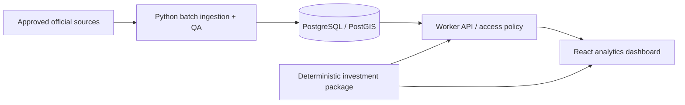

# Architecture
Decision: Cloudflare-compatible React static frontend and Worker API; Supabase PostgreSQL/PostGIS when approved; Python batch ingestion separate from Workers. No external infrastructure is created in Phase 0.

Current execution: web consumes explicit shared synthetic fixtures directly. API handler is tested independently. Database, batch scheduling and remote API bindings are not connected. No process or successful unit test establishes remote readiness.

## Data boundaries
Canonical projects carry aliases, district, optional location/tenure/completion and source ID. Transactions carry source record ID, transaction date, price, area, sale type, observed floor band, retrieval timestamp, quality flags and synthetic marker. SQL uses snake_case; TypeScript uses camelCase; production adapter mapping must be explicit and tested. Raw snapshots should be immutable with content hashes and restricted retention according to source terms. Preserve rejects and completeness metrics in ingestion runs. Rentals, land parcels, progressive schedules and regulatory-rule tables follow only with verified definitions.

Public API future: GET /api/v1/projects?q=…; GET /api/v1/projects/:id/transactions with pagination and permitted fields; POST /api/v1/comparisons with versioned financial assumptions. These are design contracts, not implemented routes. Only GET /health and GET /api/v1/demo/transactions exist. Unknown routes return 404; writes return 405. Live routes require input validation, freshness, licensed field filtering and access control first.

## Financial contract
Current: mortgagePayment(principal, annualRateDecimal, months); xnpv(rateDecimal, datedFlows); xirr(conventionalDatedFlows). Future simulateInvestment(input) returns dated equity/mortgage ledger, capital requirements, NOI, exit proceeds, profit, XIRR, rule versions, provenance and warnings. Input includes buyer profile, effective acquisition date, loan schedule, staged payments, rent commencement, operating expenses and sale scenario. Missing mandatory inputs must fail, never silently assume zero.

## Operations
Batch ingestion must fit measured source rate limits and runtime duration. Schedule short work in queues/cron only after platform limits are verified; run longer Python jobs on an explicitly approved batch host. No Python-in-Worker assumption. ECharts and MapLibre visualizations are later milestones once meaningful series and licensed tiles exist. ECharts is installed for that workflow; maps are not configured. Structured logs must exclude credentials and personal data.
